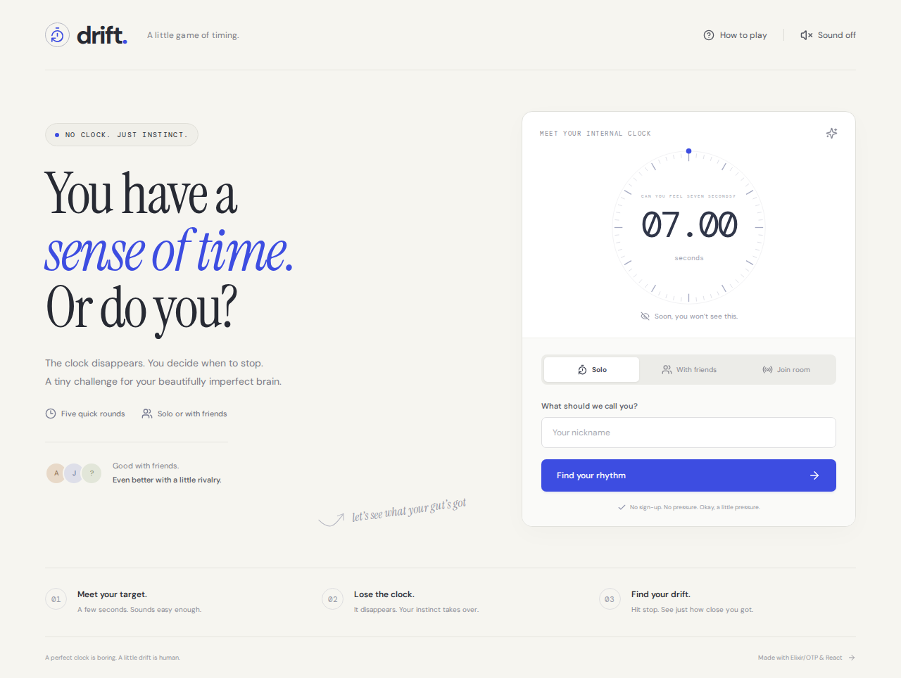

# Drift

**Trust your timing. Lose track of time.**

A multiplayer timing game built with Elixir/OTP and React, where players compete to stop a hidden timer closest to the target.



## The game

Your target is **7 seconds**. The timer starts, stays visible for 1.5 seconds, then disappears. Count in your head, trust your instinct, and hit **STOP** when you think you have reached the target.

Everyone's guesses stay private until the round ends. The closest guess wins the round; the lowest total timing error across five rounds wins the match. Exact ties share the win.

One button. Five rounds. A beautifully imperfect internal clock.

## What you can play

- **Solo practice:** Challenge your own sense of time.
- **Private multiplayer:** Create a room and invite up to seven friends using its link or six-character code.
- **Five shuffled targets:** Stop at 5, 6, 7, 8, and 10 seconds.
- **Round reveals:** See guesses on a timeline and compare each player's drift.
- **Final leaderboard and rematches:** Keep the rivalry going.
- **Reconnect support:** Refresh the page and recover your seat in the same tab.
- **Host handoff:** A connected player takes over if the host disconnects.
- **Responsive interface:** Play on desktop or mobile, with optional countdown sounds.

A round ends when everyone stops or eight seconds after the target. Missing a round adds a 20-second error penalty.

## Run locally

Requires **Elixir 1.18.3 + Erlang/OTP 27**, **Node.js 24**, npm, Git, Make, and Bash 4.3+. These are the versions used for development; see [the development guide](docs/development.md) for tooling details.

```sh
git clone https://github.com/arnavsx3/Drift.git
cd Drift
make setup
make dev
```

Open **http://127.0.0.1:5173**. Ctrl+C stops both servers. No database, account, or API key is needed.

For a two-player test on one machine, use two different browser sessions, such as a normal and private window. Your current tab stores a private reconnect token; a new tab can join as another player.

## Tech stack

| Technology | Purpose |
| --- | --- |
| **Elixir** | Game rules, room state, round coordination, and scoring |
| **Erlang/OTP** | Runtime, lightweight processes, messaging, and supervision |
| **Cowboy** | HTTP and WebSocket connections; serving the built frontend |
| **React + TypeScript** | Lobby, game interface, results, and connection state |
| **Vite** | Frontend development and production builds |

Each room runs as its own supervised Elixir `GenServer`. The server owns its clock, state transitions, and scores. React sends player actions and receives public snapshots over WebSockets. The backend uses Elixir's built-in JSON support.

## Repository structure

```text
drift/
├── backend/
│   ├── config/             # Runtime configuration
│   ├── lib/
│   │   ├── drift/          # Room processes, game rules, and supervision
│   │   └── drift_web/      # Cowboy HTTP and WebSocket handlers
│   ├── test/               # Backend regression tests
│   ├── mix.exs
│   └── mix.lock
├── frontend/
│   ├── public/
│   ├── src/
│   │   ├── components/     # Shared interface components
│   │   ├── features/       # Gameplay and results
│   │   └── lib/            # Connection hook, types, and helpers
│   ├── e2e/                # Browser integration tests
│   └── package.json
├── docs/                   # Architecture, protocol, and development
├── scripts/                # Combined local development command
├── .github/workflows/      # CI checks on pushes and pull requests
├── Makefile
└── README.md
```

## Checks

```sh
make check
```

Runs backend and frontend formatting checks, compilation, unit tests, the frontend build, and the frontend dependency audit.

For browser integration tests:

```sh
cd frontend
npx playwright install chromium
cd ..
make e2e
```

The browser suite exercises complete solo matches, rematches, multiplayer, private guesses, reconnects, host transfer, invalid rooms, and responsive layouts.

## A few things to know

- Rooms and scores live in memory. Rooms expire after 15 minutes without game activity; a server restart clears them.
- Scores use the time a stop message reaches the server. Network delay affects results, so use a stable connection. Drift is a casual game, not a latency-neutral competition.
- Invite links created on localhost work on that machine. Playing across devices requires a reachable deployment and the appropriate allowed origin.
- [Development notes](docs/development.md#dependency-advisory) document the current transitive Cowlib advisory and Cowboy's enabled response-header mitigation.

Read the [development guide](docs/development.md), [architecture](docs/architecture.md), [WebSocket protocol](docs/protocol.md), and [contributing notes](CONTRIBUTING.md) for more.
