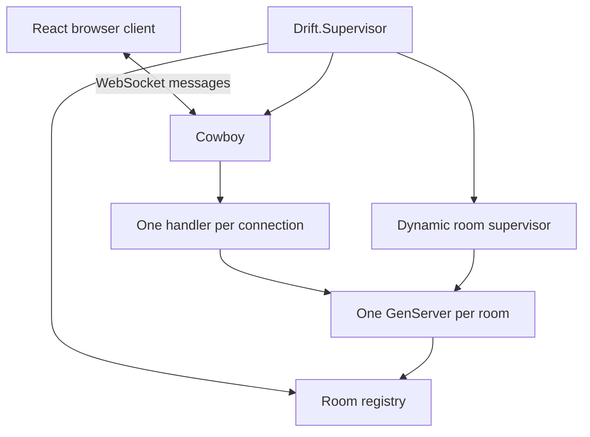

# Architecture

Drift is an Elixir/OTP application with a React + Vite frontend. Cowboy handles HTTP and WebSockets directly; there is no Phoenix application or database.

## Ownership

- `Drift.Application` starts the supervision tree.
- `Drift.Rooms` creates temporary room processes and resolves join codes.
- `Drift.Room` owns players, round state, timers, and scores. Its mailbox serializes competing player actions.
- `DriftWeb.Socket` validates messages, tracks a connection's room, and forwards public state to that client. It monitors the room and closes the connection if the room disappears.
- `DriftWeb.Server` starts Cowboy and serves the built frontend alongside `/ws` and `/health`.
- React's `useGame` manages the connection, heartbeat, seat credentials, and reconnect backoff. The game feature renders server-owned state and a local visual clock.

## Failure boundaries

Each room is a temporary supervised child. A room failure affects that match rather than intentionally recreating an empty match under the same code. Other rooms remain available. A backend restart clears all rooms.

Player sockets are monitored by their room. Disconnects mark seats offline and transfer host control. A secret resume token recovers a seat and invalidates any prior connection to it. Tokens live in session storage and are never included in public room snapshots or invite URLs.

## Timing

The server schedules a three-second countdown using its monotonic clock. It records elapsed time when it receives `stop`. Client animations do not determine scores. A finite deadline finishes each round even if a player leaves or never submits.

Network delay influences both the start animation and stop receipt time. The application makes no claim of competitive, latency-neutral timing. Protocol and scoring details are in [protocol.md](protocol.md).

## Deliberate limits

The first version uses one server and in-memory room state. It does not provide accounts, permanent match history, cross-node room coordination, or protection against a player using an external clock or a scripted client. The frontend loads optional Google Fonts; system fonts remain available if that request fails.
