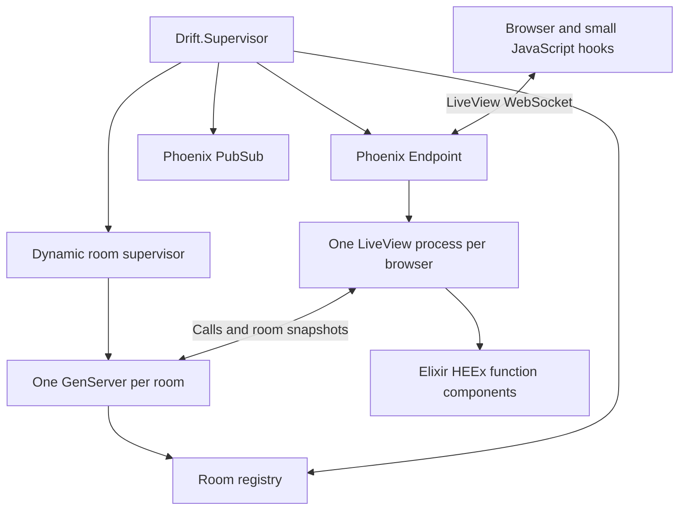

# Architecture

Drift is an Elixir/OTP application using Phoenix LiveView. Elixir owns the game and renders the interface. Cowboy and Plug provide Phoenix's HTTP/WebSocket transport. There is no database.

## Ownership

- `Drift.Application` starts the registry, room supervisor, Phoenix PubSub, and endpoint.
- `Drift.Rooms` creates bounded, temporary rooms and resolves join codes.
- `Drift.Room` owns players, countdowns, round deadlines, private submissions, scoring, and host transfer. Its mailbox serializes competing actions.
- `DriftWeb.Endpoint` serves generated assets and exposes LiveView's `/live` transport. `DriftWeb.Router` applies session, CSRF, and secure-header protection.
- `DriftWeb.GameLive` manages one browser's seat, form state, UI actions, room monitor, and reconnect restoration. It calls the room with its own process identity and receives public snapshots as Elixir messages.
- `DriftWeb.HomeComponents`, `MatchComponents`, `ResultsComponents`, and `UIComponents` render the screens using HEEx inside Elixir modules. `Presentation` supplies ranking, labels, and timeline positions.
- `assets/src/app.js` contains LiveView hooks for the animated clock, sound, clipboard, modal focus, and session storage. These browser APIs need a small JavaScript layer. They never decide scores.
- Vite builds the hook bundle and Tailwind stylesheet into ignored `backend/priv/static` files. There is no React application or separate frontend server.

## Failure boundaries

Each room is a temporary supervised child. A failure affects that match; the supervisor does not recreate an empty room under the same code. Other rooms remain available. A backend restart clears rooms.

Rooms monitor the LiveView processes occupying their seats. A disconnect marks the seat offline and transfers host control to a connected player. Explicit leave detaches the seat while keeping the LiveView alive on the home screen. A secret resume token restores the same seat and invalidates its previous connection.

The token lives in session storage for that tab, never in public snapshots or invite links. The LiveView client sends it as a connection parameter on reconnect or refresh. An invite to a different room takes precedence over the saved seat. Expired rooms and replaced connections clear the saved seat.

## Timing

The room schedules a three-second countdown using its monotonic clock. The server records elapsed time when it receives a stop action. Browser animation does not determine scores. A finite deadline ends the round even when a player disconnects or never submits.

The browser anchors its animation from `starts_in_ms` on a new round or remount. Animation frames update the local dial without WebSocket traffic. Network latency influences both the displayed start and stop receipt time; Drift is a casual timing game. See [protocol.md](protocol.md).

## Deliberate limits

One server, in-memory matches, eight players per private room, and at most 500 active rooms. No accounts, permanent history, cross-node room ownership, or protection against external clocks and scripted clients. Google Fonts are optional; the stylesheet supplies system fallbacks.
